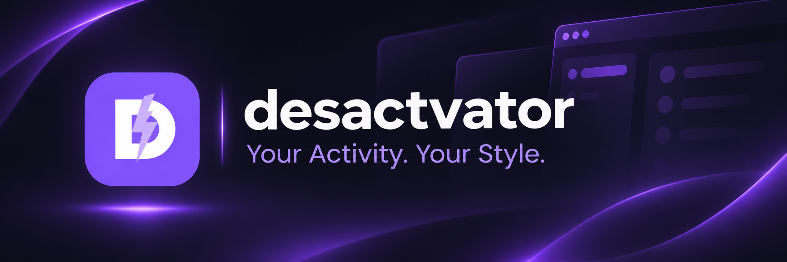

  

<h1 align="center">desactvator</h1>

  <strong>Your Activity. Your Style. Your Experience.</strong>

  A modern, powerful and highly customizable Discord Rich Presence activity manager for Windows.

  
  
  

---

## ✦ A New Way to Express Your Presence

**Your Discord presence deserves more than just a basic interface.**

Meet **desactvator**, a desktop experience built to make Discord activity management feel effortless, powerful and uniquely yours.

Inspired by the foundations of Disactivity, desactvator is being developed with a new visual identity, a modern technology stack and an ambitious vision for customization.

Designed for users who value **control, personalization, simplicity and performance**.

> **One application. Thousands of activities. Endless possibilities.**

---

## ✦ The desactvator Experience

|  | Experience | Our Vision |
|:---:|---|---|
| 🎨 | **Designed Around You** | A beautiful, customizable interface that feels personal. |
| 🎮 | **Your Activity, Your Choice** | Discover, organize and manage Discord game activities. |
| ⚡ | **Lightweight by Design** | Responsive interactions and efficient desktop integration. |
| 🛡️ | **Built for Reliability** | Stable processes, predictable behavior and safer configuration management. |
| ✨ | **More Than the Basics** | Activity presets, timers, appearance controls and more. |

---

## ✦ A Look Into the Future

**An entirely new visual experience is taking shape.**

The planned interface combines deep dark surfaces, vibrant violet accents, elegant typography, fluid transitions and carefully designed components.

*Official previews and screenshots will be added as development progresses.*

---

## ✦ Features & Capabilities

### Activity Management

- Extensive game activity catalog
- Fast and intuitive search
- Favorites and quick access
- Activity lifecycle management
- Saved activity presets
- Custom activity timers
- Local activity history

### Personalization

- Premium dark interface
- Custom accent colors and themes
- Adjustable interface layouts
- Customizable game cards
- Optional animations and effects
- Appearance presets
- Import and export of settings

### Desktop Experience

- Native Windows integration
- Multilingual interface
- System tray support
- Persistent preferences
- Configuration backup and restoration
- Activity and process diagnostics
- Secure automatic update infrastructure

**Note:** These features represent our development goals. Availability will vary by version, and some systems are not yet implemented.

---

## ✦ Development Roadmap

| Phase | Focus | Status |
|:---|---|:---|
| **01 — Foundation** | Application architecture and core activity management | In development |
| **02 — Visual Evolution** | Premium interface, design consistency and animations | In progress |
| **03 — Personalization** | Themes, layouts and appearance controls | Planned |
| **04 — Advanced Tools** | Activity presets, timers, history and diagnostics | Planned |
| **05 — Distribution** | Signed updates, installers and release preparation | Planned |
| **06 — Public Release** | Final validation and first official build | Not announced |

Our development philosophy is simple:

**Build carefully. Test thoroughly. Release when ready.**

---

## ✦ Powered by Modern Technology

| Technology | Role |
|:---|:---|
| **Tauri 2** | Native desktop framework |
| **Rust** | Backend and system integration |
| **React** | User interface |
| **TypeScript** | Type-safe application development |
| **Tailwind CSS** | Styling and visual components |
| **Vite** | Frontend tooling |

Our goal is to combine a flexible modern frontend with a reliable native foundation.

---

## ✦ Design Principles

**Beautiful by design. Practical by nature.**

We believe great software should feel as good as it looks.

That means focusing on:

- **Visual consistency** — Every component belongs to the same design system.
- **Clarity** — Information should be easy to understand and access.
- **Customization** — Users should have meaningful control over their experience.
- **Responsiveness** — Smooth interactions without unnecessary complexity.
- **Reliability** — Features should work consistently, not just look impressive.

---

## ✦ Release Information

> **Development Status: Active**
>
> desactvator is currently undergoing development and testing.
>
> No official public builds or releases are available at this time.
>
> The first release date has not been announced.

The Releases section will remain empty until a version is ready for distribution.

---

## ✦ Credits & Acknowledgments

desactvator is an independent project based on the open-source [Disactivity](https://github.com/holasoyender/disactivity) application.

We acknowledge the original developers and contributors for their work.

The original project's MIT License and required copyright notices will be preserved. Additional third-party license notices will accompany applicable distributions.

This project is not affiliated with or officially endorsed by Discord Inc.

Discord and related trademarks belong to their respective owners.

---

### desactvator

**Your Activity. Your Style. Your Experience.**

*Built with attention to detail. Designed for what comes next.*
